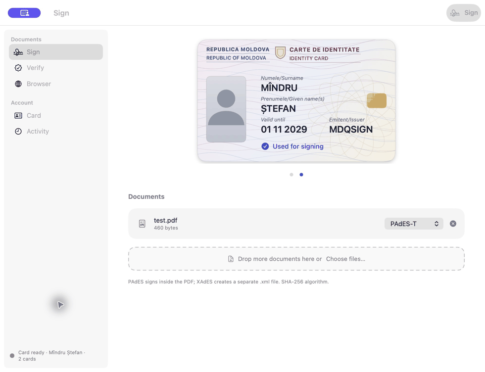

# eSemnBun

Sign and verify documents with a Moldovan electronic identity card. eSemnBun supports macOS, iOS, Android, Windows and Linux, with a command-line interface for desktop systems.

A short capture of the native macOS app: documents, card selection, verification and certificate details.

## What you can do

- Sign PDFs and other documents, including batches, with a compatible card and USB reader.
- Verify signatures and choose between connected cards.
- Use supported government services through the browser integration.
- Work in Romanian, English or Russian, with light and dark themes.

## Get started

Download an installer from [GitHub Releases](https://github.com/xfreebird/smartcard/releases). Connect a compatible identity card and reader, open eSemnBun, and choose the documents to sign. A PIN is required to authorize signing.

Build instructions and platform requirements are in the [documentation](docs/README.md). The [development plan](PLAN.md) tracks platform support and outstanding work.

## Feedback

Report issues and feature requests in [GitHub Issues](https://github.com/xfreebird/smartcard/issues). Include your platform, app version and steps to reproduce; avoid sharing PINs or personal documents.

## License

Copyright © 2026 Nicolae Ghimbovschi. Licensed under the [MIT License](LICENSE). Third-party components and assets may have their own licenses.

[esemnbun.md](https://esemnbun.md)
