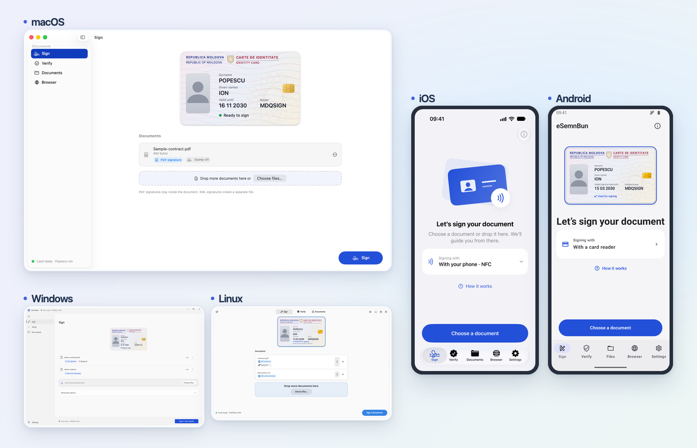

# eSemnBun

Sign and verify documents with a Moldovan electronic identity card. eSemnBun supports macOS, iOS, Android, Windows and Linux, with a command-line interface for desktop systems.

## What you can do

- Sign PDFs and other documents with a compatible identity card. Use NFC on supported iPhones and Android phones or connect a USB card reader.
- Verify signatures and choose between connected cards.
- Use supported government services through the browser integration.
- Work in Romanian, English or Russian, with light and dark themes.

## Get started

Install eSemnBun from the [Downloads page](https://esemnbun.md/downloads/). Choose the documents to sign, select NFC or a card reader where supported, and authorize signing with your card’s PIN.

For the CLI, use [Homebrew, Scoop, Chocolatey, APT, DNF or the Arch recipe](https://esemnbun.md/downloads/). On macOS: `brew install xfreebird/utils/esemnbun-cli`. Packaging and signing details are in [CLI distribution](distribution/packages/README.md).

New contributors: start with [developer onboarding](docs/13-developer-onboarding.md), including your own VM/device access setup and the [repo skills](.agents/skills/). Build instructions and platform requirements are in the [documentation](docs/README.md). See [build automation](distribution/BUILD-AUTOMATION.md) for installer and store-upload actions. The [development plan](PLAN.md) tracks platform support and outstanding work.

## Feedback

Report issues and feature requests in [GitHub Issues](https://github.com/xfreebird/smartcard/issues). Include your platform, app version and steps to reproduce; avoid sharing PINs or personal documents.

## License

Copyright © 2026 Nicolae Ghimbovschi. Licensed under the [MIT License](LICENSE). Third-party components and assets may have their own licenses.

[esemnbun.md](https://esemnbun.md)
