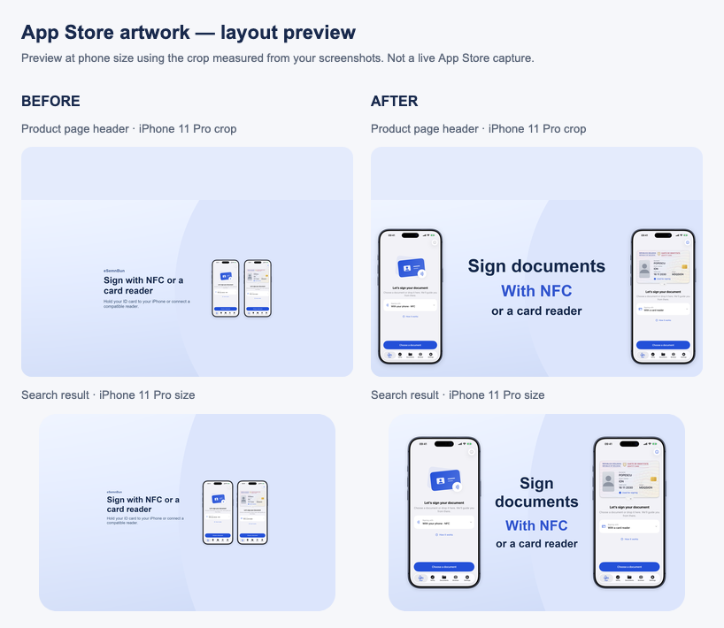
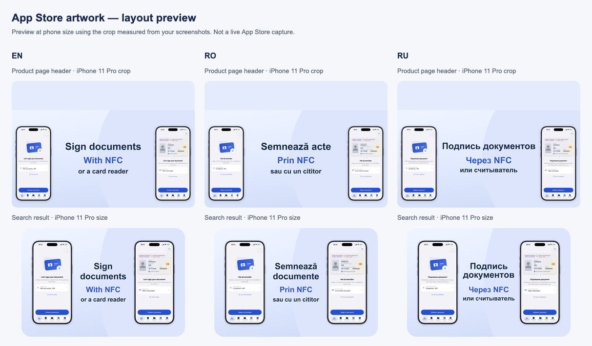

# iOS Header and Search Results artwork — 17 November 2026

Status: the owner approved publication, and all six exact replacement images were uploaded to App Store Connect and submitted as an independent artwork review. Submission `2dd22b15-02ec-4e90-bdd9-f8f77d061cb0` was read back as `WAITING_FOR_REVIEW` on 17 November 2026. iOS 0.2.12 remains `READY_FOR_SALE`; no app version or binary was created or changed.

The live listing still uses the prior approved images. In Firefox, the released version's Browse Assets dialog explicitly permits replacing current artwork but restricts selection to **Approved** assets. These replacements can be selected for Header and Search Results in en-US, ro and ru after Apple approves them. Do not describe this submission as a completed public rollout.

## Design correction

The previous composition compressed a headline, a paragraph and two complete phones into Apple's central art-safe area. At iPhone 11 Pro scale the phones and copy were too small, with excessive unused space around them.

The replacement uses a short signing headline, NFC and card-reader messaging, and two large native Sign screens. The header keeps a single-line headline between the phones; search uses two lines. The entire message stays inside the official safe rectangle. Phone bodies extend into auxiliary space and may be cropped on other aspect ratios, while the message remains intact. Header phones start below the navigation buttons in the measured portrait layout. All native screens contain fictional identities and retain their original pixels.

- Header phone height increased from 542 to 1280 pixels in the 3840 × 1646 composition.
- Search phone height increased from 845 to 2000 pixels in the 3840 × 2560 composition.
- Removed the small duplicated app name and explanatory paragraph.
- Localized the concise message in English, Romanian and Russian; source is `localization/catalog.json/storeCreative`.

## Validation

The owner supplied `IMG_0600.PNG` (search) and `IMG_0601.PNG` (header), both 1125 × 2436. Matching the prior artwork against these references measured the header at scale 0.364, offset (-136.308, 180.548), and search at 0.262, offset (58.968, 666.570). Matching confidence was 0.967 and 0.948 respectively. These measurements are approximations of the observed portrait composition, not universal App Store transforms.

Firefox rendered comparison and all-language boards at a 375-point phone width, with the search card at 335 × 223 points. These are explicitly labeled layout previews, not screenshots of an updated live listing. English, Romanian and Russian were visually inspected. Exact output dimensions, RGB without alpha, source/output hashes and safe-area bounds were checked for all six files. No native app build was needed.

## Files and delivery

Canonical sources and export manifests are in `distribution/apple/creative/source/` and `distribution/apple/creative/current/`. Regenerate with `distribution/tools/compose-apple-creative.py`, then `distribution/tools/export-apple-creative.py`; see `distribution/apple/creative/README.md`. Each composition records both native capture hashes and the official device-frame identity.

Apple supports reviewing creative assets independently of a new app version through Asset Library. The current draft-version uploader intentionally requires an editable version; do not create a new app version just to bypass that guard. The upload and submission are complete. Apple review and replacement of the six live placements remain. See [the upload receipt](apple-featured-2026-11-17/upload-receipt.json) for exact file hashes and asset IDs.

References: [creative asset specifications](https://developer.apple.com/help/app-store-connect/reference/app-information/creative-assets-specifications/), [asset best practices](https://developer.apple.com/app-store/asset-best-practices/), [standalone asset submissions](https://developer.apple.com/help/app-store-connect/manage-submissions-to-app-review/submit-assets-from-asset-library/).
