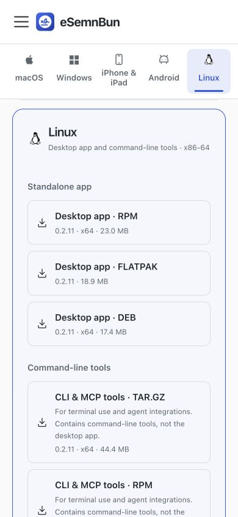

# Mobile downloads navigation — 15 November 2026

Published at https://esemnbun.md/downloads/ from `13ff6b70531946cbd5680a0382c219ff32a1002c`.

All five platforms now fit in a sticky icon-and-label row on phones. The active platform has a
soft background and underline. Scrolling updates the selection, selected card and URL without
adding history entries. Anchor jumps account for the measured navigation height. Keyboard
activation moves focus to the destination card; side-by-side desktop cards preserve the chosen
column. Small-screen labels and translated footer links wrap without widening the page.

## Verification

[Website workflow 43683664572](https://github.com/xfreebird/smartcard/actions/runs/43683664572)
succeeded: 34 tests, guide organization and illustration validation, the three-language production
build, SEO/discovery validation, artifact upload and GitHub Pages deployment. Eight new regression
cases cover scroll direction, tall/short cards, sticky controls, gaps, desktop ties and legacy links.
Local validation was limited to source syntax and whitespace checks; builds/tests ran in CI.

Live Chrome checks covered:

- 320 × 568 and 390 × 844 phone viewports: five visible links, usable tap areas and intact labels.
- Tapping every platform, keyboard activation, accurate anchor positioning and direct/legacy links.
- Upward scrolling from Linux selecting iPhone/iPad, then downward scrolling selecting Android.
- Keeping Linux selected deep within its long card and preserving Windows selection in a desktop row.
- Desktop at 1280 × 900, light/system and dark appearance, and EN/RO/RU downloads.
- Final EN/RO/RU document width of 320 pixels at a 320-pixel viewport; translated footer links wrap.
- No captured browser console errors on the final English page.

The first narrow-screen review found a broken Windows label; the next review found translated
footer overflow. Both were corrected and deployed. A cached Romanian document initially retained
the older stylesheet; reloading the deployed page confirmed the new wrapping rule and 320-pixel
width. `browser-checks.json` retains these intermediate observations as well as final checks.
The original appearance preference and browser viewport were restored after inspection.
Physical iPhone Safari was not exercised; these are Chrome responsive-browser checks.

## Screenshots

[Before at 390 pixels](before-390.jpg) · [After at 320 pixels](after-320.jpg) ·
[Russian footer at 320 pixels](footer-ru-320.jpg)

